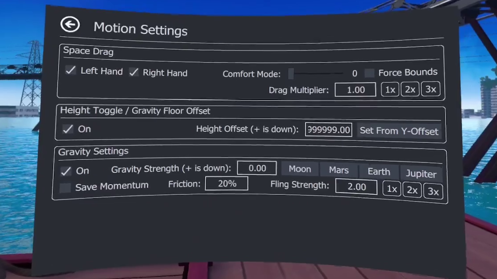
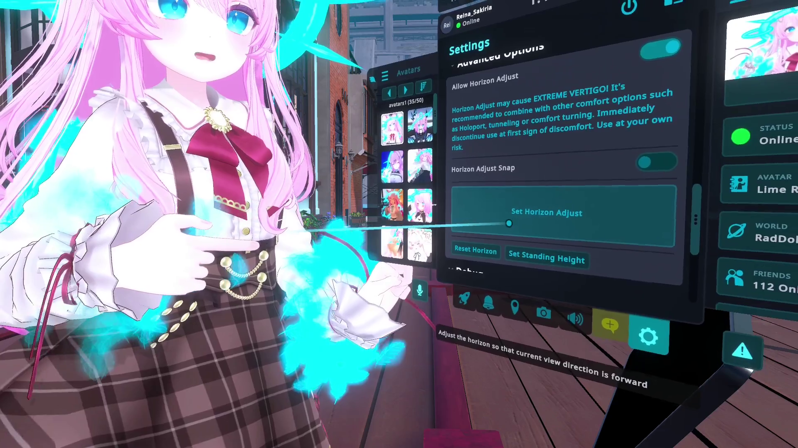
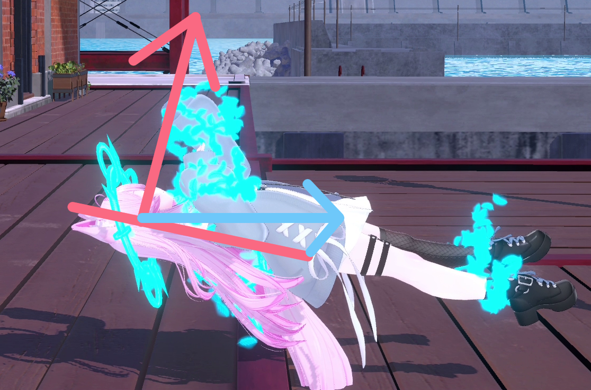
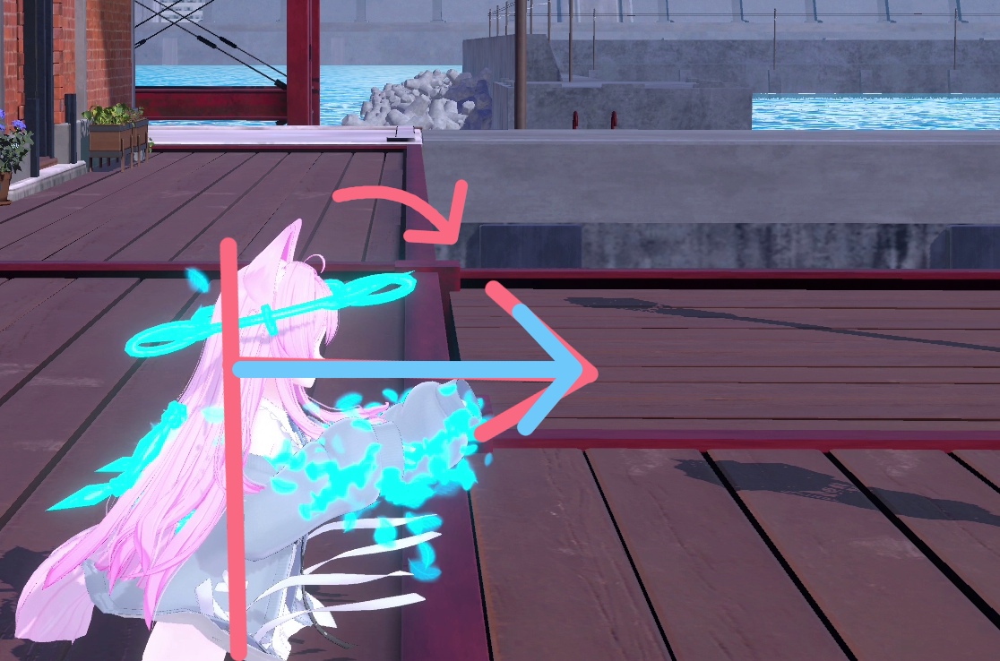
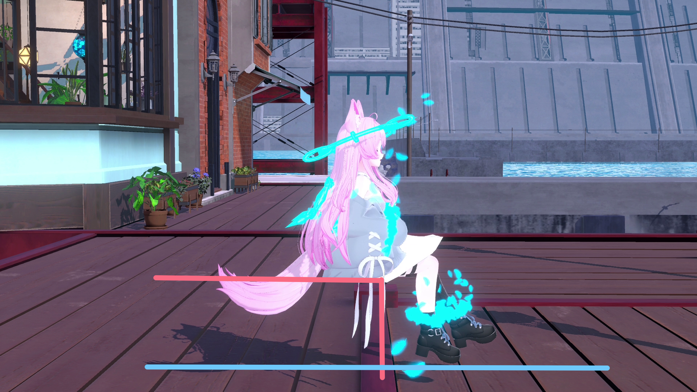
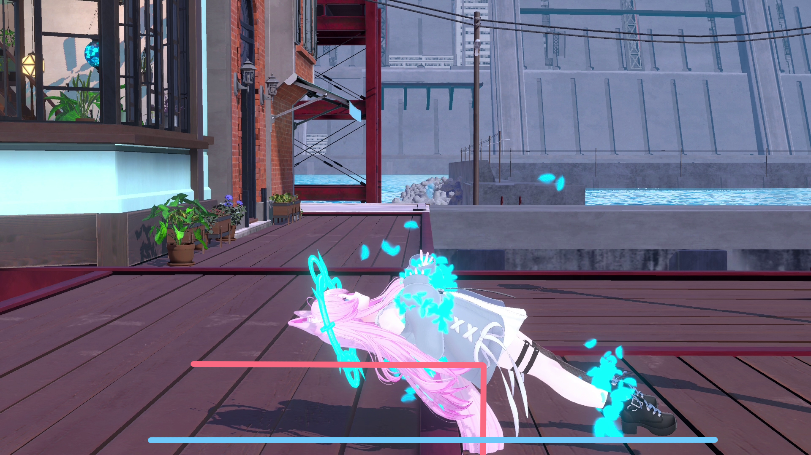
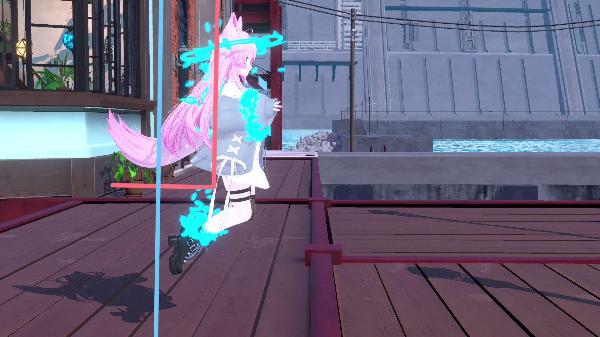
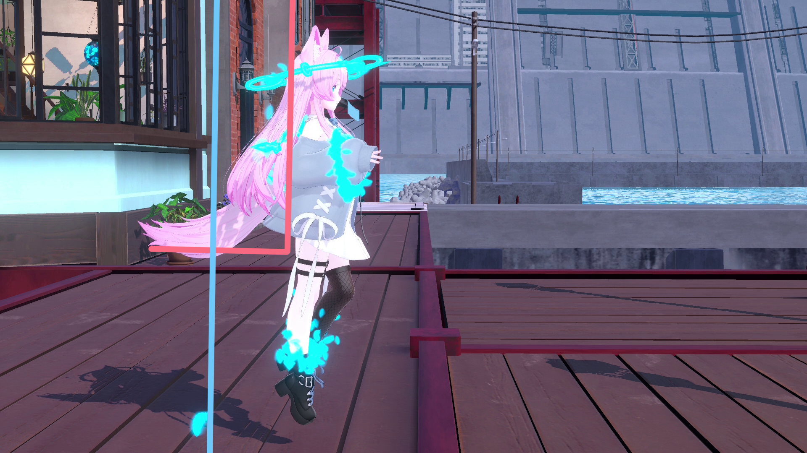
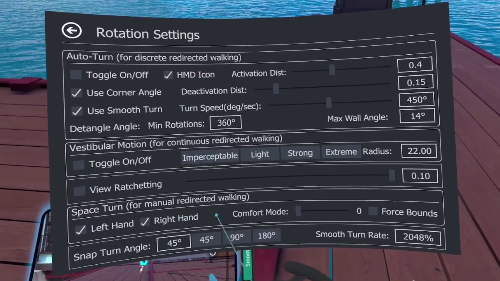
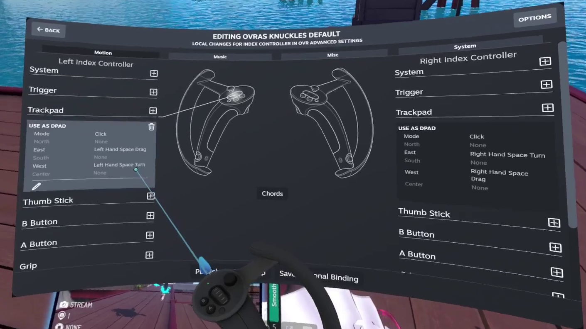

+++
date = '2026-03-13T19:30:09+0900'
title = '自由に飛行できる技術'
+++

## はじめに

VRChat を遊んでいて

もっと自由に空を飛んでみたいと思ったことはありませんか ... ？

私は、ゲームで空を飛ぶのが結構好きです。

[Minecraft](https://www.minecraft.net/ja-jp) の [エリトラ](https://ja.minecraft.wiki/w/%E3%82%A8%E3%83%AA%E3%83%88%E3%83%A9) と [花火](https://ja.minecraft.wiki/w/%E3%83%AD%E3%82%B1%E3%83%83%E3%83%88%E8%8A%B1%E7%81%AB#%E3%82%A8%E3%83%AA%E3%83%88%E3%83%A9) や Mod では [Botania](https://botaniamod.net/index.html)/フリューゲルティアラ や [Mekanism](https://github.com/mekanism/Mekanism)/ジェットパック 、 [Splatoon シリーズ](https://www.nintendo.com/jp/character/splatoon/index.html) の スーパージャンプ 、[カービィのエアライダー](https://www.nintendo.com/jp/games/switch2/aaaba/index.html) の エアライドマシン など、あげていくときりがないですね。

せっかく VRChat 、 VR なのだから　... 空、飛びたいですよね！

## このブログについて

このブログは Reina_Sakiria が普段から使用してきた **自由** に **飛行** できる **技術**

題して

「**自由飛行技術**」

その技術について適当を書き連ねたブログです！

(以後 Reina_Sakiria が普段使用している自由に飛行できる技術のことを、「自由飛行技術」または 「自由飛行」と表記します。)

また、この動画を blog の形に書き直したものになります。



## 既存の技術

VRChat を VR で遊んでいれば、空間を掴んで動かすことことに覚えがある人は多いと思います。

宙に浮く、地面から離れる程度であれば、 [OVR-AdvancedSettings](https://github.com/OpenVR-Advanced-Settings/OpenVR-AdvancedSettings) の 「Space Drag」 で、誰であっても 空間を掴んで動かすことで 浮くこと はできますね！

(以後 [OVR-AdvancedSettings](https://github.com/OpenVR-Advanced-Settings/OpenVR-AdvancedSettings) のことを 「OVR-AS」 と表記します。)  
(以後、人々がよく「OVR」と、「[SteamVR](https://www.steamvr.com)」の開発者向けな名称「[OpenVR](https://github.com/ValveSoftware/openvr)」と名前が衝突していおり紛らわしい呼称で呼ばれている OVR-AS の 空間をコントローラーの移動と共に合わせて移動させ、空間を掴んで移動させることができる機能であるところの「Space Drag」を「Space Drag」と表記します。)

Space Drag で浮くことは出来ても、 3点 では足が常に地面に引っ張られて、とてもではないけど飛べているとは言えないし、フルトラでも、何もしなければただ浮いているだけにしかならない。

他には、コライダージャンプと呼ばれる、バグなのか仕様なのかわからない仕組みで空を飛べますが、あまりにも挙動がバグじみていて良いものではない。

空を飛ぶにしても、浮いている程度じゃなくて、ガタガタもなく、もっときれいに飛びたいですよね ... ！

## でもどうすれば

VRChat は VR の世界ですが、中身の人間は物理法則に縛らています。部屋を無重力空間にすることは出来ないし、[ナーヴギア](https://dic.pixiv.net/a/%E3%83%8A%E3%83%BC%E3%83%B4%E3%82%AE%E3%82%A2)はまだ現実になっていない。

でも、人間を物理的にワイヤーを取り付けて釣り上げれば解決ですね ... !

いや〜 ... できたらいいね () どれだけのお金がかかるのでしょうか ... 一応学生の身分の私には出来ないですね ... ()

でも！ VRChat では重力を消すことは出来なくても、重力の方向を変えることが出来ます！

## 重力の方向を変えると

知ってる人は知ってると思うんですが、[Horizon Adjust](https://wiki.vrchat.com/wiki/Horizon_Adjust) (日本語名称 水平線の調整) をつかうと重力の方向を変えてしまうことが出来ます！

それと同時に OVR-AS の SpaceDrag などをうまく使ったうえで、フルトラでかなり頑張るとこんなふうに、いい感じに空を飛べます！



## どうして飛んでいるようにできるのか

さっき「重量の方向を変える」と書いたもののそれだけだと分かりづらいですよね。

実際に [Horizon Adjust](https://wiki.vrchat.com/wiki/Horizon_Adjust) を適当につかっても、ただ立ったまま回転する程度で、逆立ちしたり壁歩きしたりは出来ますが、空を飛んでいるようには ... 見えない。

(なんなら、そうなるのはフルトラでの話で、3点だと、とても奇妙なポーズになるだけ)

人間が地面に立っている限り、空を飛んでいるような姿勢は出来ません。でも、重力の方向は変えることが出来ます。

ならば、ベッドに寝っ転がって重力の向きを変えれば、空を飛んでいるように魅せることができます！

実際にそのセットアップをゆっくりやるとこんな感じ



(ベッドに浅く座って、上半身を倒して、Horizon Adjust を使用して、腹筋などを使って足を頑張って重力に逆らいながら動かす ... )

つまり、自由に飛んでいるように魅せる、自由飛行技術の核は、寝てる姿勢を縦にして足をフルトラでうまく動かすことにあります。

## 前提事項

これからやり方の話をしたいので、前条件を少し明記するね。

この技術を使うに当たって前提としてこれらのものが必要になるよ〜！！！

- フルボディトラッキングができる機材、安定性の良い ライトハウス系の VIVE Tracker などが良い。
- OVR-AS　の導入、SpaceDrag のセットアップ。
- やる気、根気、空を飛びたいと思う強い意志。

## やりかた

### OVR-AS の設定

自由飛行技術の話で、ここまでは重力方向の話しかしていませんが、ふわふわとした移動をするには OVR-AS の設定をいじる必要があります。

(OVR-AS の SpaceDrag はそのままだとカクカクした動きしか出来ず、これでは飛んでいるように魅せるためにはふわふわした挙動にする必要があります。)

OVR-AS の Motion Settings を開きましょう。このような画面が出でます。

自由飛行するに当たって必要な設定はこんなかんじ

- Gravity Settings
  - On を有効化 (画像のように ☑️ がついていれば有効)
    - Gravity 機能を有効化します。
    - この機能は通常、 Space Drag で上にジャンプするような挙動を可能にする機能です。
  - Gravity Strength を　0　に設定
    - この時数値入力を直接行う必要があります。 SteamVR のキーボードが出てくるので、それを使用して 0 を入力した後 右下の ☑️ を押すことで決定できます。 (Enter を押しても反応しません ... (どうして) )
    - 重力から重力の強さを 0 にし、無効化することによって宙に浮くことが出来ます。
  - Friction を 20% ~ 5% に設定
    - この値は強ければ強いほど、早く止まるようになります。
    - 下の Fling Strength との兼ね合いで強さを決めると私は良いと思います。
    - たとえば Fling Strength を 2.0 で Friction を 20% や Fling Strength を 1.0 で Friction 10% など
    - Gravity Strength　を　0 にした後、この値を設定しない場合、永遠と同じ方向に進み続けてしまい止まることが出来ません。必ず設定しましょう。
  - Fling Strength を 1.0 ~ 2.0 の範囲で設定 (デフォルトは 1.0 なのでいじらなくても良い)
    - SpaceDrag で空間を掴み、加速する時のブースト値です。
    - 高ければ高いほどぶっ飛び、高速に長距離を移動できる代わりに制御が難しくなります。
    - 慣れないうちは 1.0 で 上記 Friction を強めにしても良いと思います。
- Height Toggle / Gravity Floor Offset
  - On を有効化
    - OVR-AS の思う仮想的な床 をずらす機能です。 Height Offset の分だけ上下に床をずらします。
    - 自由飛行技術の場合は地面の下に進める必要があるので、有効化する必要があります。
      - 自由飛行時は重力の向きが変わるので「下に進む」が「後ろに進む」に変わるので、床をずらしておかないと後ろに進む時に仮想的な地面に激突してうまく動けなくなるためです。
  - Height Offset に 大きな値を入れる
    - 現実的には 100.0 程度でも支障は出ませんが、画像のように ~9999999.0 を入れたほうが良いです。

最後に ... うまく地面にふわふわした状態で沈めない(仮想的な床の位置が変わっていない)などがあったら、 Gravity Settings の On や Height Toggle の On をガチャガチャすると治ることがあります。

設定がうまく行っていればこんな感じに動けるようになっていると思います。



### Horizon Adjust を使う

小さいメニューの　Settings　/ Advanced Option / Horizon Adjust にあります。

Allow Horizon Adjust を有効にすることで、使用することができるようになります。

つぎに、 Set Horizon Adjust のボタンを使用することで Horizon Adjust できます！

#### Horizon Adjust の挙動

概ね、向いている方向を正面方向に向けるようにプレイヤーの空間を回転させてくれます。

こんな感じに (赤がプレイヤーの向いている軸、青が大まかな正面方向)

使用前

使用後

画像のように寝っ転がってから使用すると、概ね縦に直すような動きをしてくれます。

### 足を動かして姿勢をとる

前述したように、ベッドに座ってから寝っ転がって Horizon Adjust するわけですが　...

(青い線が床、赤い線がベッド、現実側のイメージ)

Horizon Adjust 後

図を見るとわかると思うのですが、ベッドから足を乗り出しています。

それによって足を浮かせることが出来ますね！　（重力に逆らって足を上げることになるので、腹筋と体幹が死にますが強く生きてくださいね！）

筋肉を鍛えて、重力に逆らい、足を上げたり、下げたりブラブラさせることで、浮いているような動きをしましょう！

うまくできていれば、ふわふわ移動できる Space Drag と回転した空間の上で頑張って足を動かして空を飛んでいるように魅せることが出来ると思います！

## 私がよくする自由飛行の動作

基礎の話はここまで、ここからは自由飛行時の姿勢制御・どんな姿勢をすれば良いのかについて、私の思う1つの解をすこしだけ述べていきますね！

### 前進・後退

シンプルな前後移動、いつでも使う、いつでも使える。




前進する時、一時的にベッドに寝っ転がった状態から上半身を起こして真上を向くという動作をすることで大きく、前に状態を倒すことができる。(腹筋と引き換えに。)

後退する時は、ベッドに更に沈むことは出来ないので、足を全力で上げることで誤魔化す必要があります。

これは他の動きにも通じますが、前進や後退が終わったタイミングの フォロースルー (メインの動作が終わった後の動き) が、かなり大事で、揺れ物のように足を固めないように体に叩き込む必要があります。

### 左右



前後と同様、非常に使用機会の多い動きです。横移動時に VRChat 側の回転を使うことで相手の裏に回り込むような動作にも応用が出来ます。お得だね

移動方向と反対方向に足をよせて、移動している感を出すのが大事、移動方向と反対側の足を曲げるとより良いかもしれない。

また、斜め方向になった時に前後方向の動きを考慮しながらうまく混ぜたような動きをすると自然になりますね！

### 細かい動き・ポーズ

細かい動きは、かわいいさ多分大きく影響します、でも普段地上での動作は、空を飛んでいると少し形が変わることになるでしょう。

なにせ、地面に足がついていない。なのでそれ相応に違う動きや姿勢を取る必要があります！

(とはいえ、そんなに資料がないですが ... 思い思いのかわいい動きをしたりポーズを取ると良いと思います ... () )





背中にはベッドがあり腕の動く範囲には限度があるし、足を上げるには腹筋を消耗するし、重力方向の違いから地上でのポージングよりもより筋力を使う必要があります。強く生きましょう ... !

## もっと自由に空を飛ぶ

Horizon Adjust を使用した時点で酔ってしまう人は多いと思います。けど、このままだと、空を飛べても横方向(ワールド Y 軸)への回転しか出来ません！

たりない！！！自由度が足りない！！！

そんなわけで OVR-AS の機能をさらに使いましょう！

OVR-AS　にある Space Tune という機能を使えば、プレイヤー空間での Y 軸　で回転することが出来ます。

(もともとは、無限歩行をするための機能ですが、自由飛行のために今回は使います。)

OVR-AS の Rotation Settings にある Space Turn (for manual redirected walking) の Left (Right) Hand を有効化した後に、Left (Right) Hand Turn のキーバインドを適当に設定しましょう。

私のキーバインドは Vulve Index なのであまり参考にならないかもしれないですがこのようになっています。

### Space Turn で出来ること

プレイヤーの空間での Y 軸で回るので実際に使ってみるとこのような挙動をします。



(Space Drag と違って Space Turn はコントローラーの回転に反応します。腕を振り回しても対して回らないので、コントローラーを重力の軸(Y軸)を意識しながら回すと大きく回すことが出来ます。)

(この Space Turn を発動した状態でコントローラーの(体と相対的な)向きを維持しながら、円形に歩くことで無限歩行が出来るというものですが今回は恣意的にコントローラーを回転させて使います。)

その プレイヤー空間での Y 軸回転を 自由飛行状態で使うと、 Horizon Adjust によって 90度 回転するので、この軸での回転になります。



(ジンバルロックに近い現象が起きているのかもしれない。)

これを利用すると、自由飛行状態で、横になったりひっくり返ったりすることができます。

ただ、この横になった状態だったとしても、 VRChat 側の回転は変わらず、 VRChat 側の Y 軸 で回転できるので、それを応用するとこういった動きが出来ます。



(Space Trun で横向きになった後、Space Drag で上方向(VRChat 側だと横方向) に加速した直後に、 VRChat 側の回転の入力をすることでこのような動きになります。)

人の後ろに回り込んだりすることが出来て非常に便利ですが、この Space Turn は基本的に三半規管をさらに破壊する技術なので酔いに耐性がついたら試してみてください ... ！

## おわりに

おそらくですが、このブログだけでは私のレベルに到達するのは非常に難しいと思います。ですが、無いよりかはあったほうが良いので書いてみました。

実際動きを学ぶならば実物を見るに越したことはないですし、私はもっと 自由飛行技術を日常的に扱えるような継承者が増えてほしいので、いずれ小規模な集会でもしてみたいものですね ... ！

Base Fly って言い出してみたら、勝手に[あのイベント](https://x.com/BaseStep_VRC)の姉妹イベントみたいになってしまいますね〜！

真面目に考えるなら ... 「天継ぎの集い」とかかな(わからんけど)、やるにしても組織運営とかしたくないから私単独で不定期開催で自由飛行技術に興味上がる人ならば誰でも歓迎っての小規模な集会になるかもしれんし、ならないかもしれんね

それじゃ ... これを見て興味が出てきた人も、空を飛びたいからこのブログを読んでいる人も ... 頑張って 自由飛行技術 の習得を頑張ってみてね ... ！



そうだ、余談を少しするね ... 自由飛行技術の今後の話

このブログで紹介した Horizon Adjust と OVR-AS の Space Drag (Turn) の組み合わせでは、出来る動きに限界があるんだ。

どうしても、 VRC 側の Y 軸回転 とプレイヤー空間での Y 軸回転の二軸でしか回れないし、その使用上 プレイヤー空間での X 軸回転 が自由に出来ない都合、回りくどい回し方をする必要があったり、横になった状態で当人の視点で横向きに回転するみたいな挙動が仕様上出来ないんだ。

これはどうしてもあり物の道具を組み合わせて成り立っている技術である以上限度があるのは仕方がないんだ ... ()

でも ... 道具は作れば良いのです。そういえば ... 私は Linux 環境に主を移して行こうと考えているので、 [MonadoXR](https://wiki.vronlinux.org/docs/fossvr/monado/) (また [WiVRn](https://wiki.vronlinux.org/docs/fossvr/wivrn/)) で動くものを作って、もっと自由飛行技術を良いものにしたいですよね ... !　

(MonadoXR には OVR-AS のような存在が、少なくとも私の要求するレベルのものがなく、私が VR のメイン環境を Windows から Linux に移せていない主要な要因でもあるので、 MonadoXR でも自由に空を飛べるようにする必要があるのです！)

たとえば、OVR-AS では出来ない、Horizon Adjust を使用した時、ガタッと 1f で回転してしまうのを滑らかに状態を倒したりとか、空間を掴む動作でぴたっと止まってしまう挙動をブレーキのような動きにして滑らかにしたりしたいですね ... !

SteamVR (OpenVR) でも、できなくはなさそうですがさらなるリバースエンジニアリングが必要になりそうなので、 MonadXR 系　専用になってしまうかもしれませんが ... 仕方がないね！


