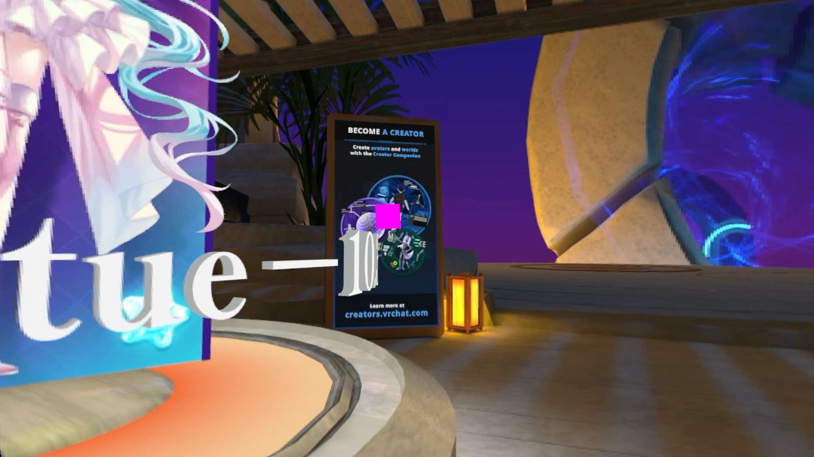
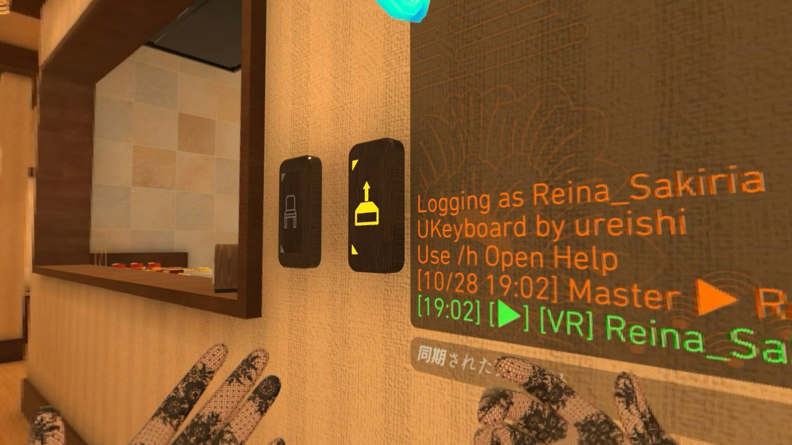

+++
date = '2026-10-29T17:18:56+0900'
title = 'VRChatでDFR!?'
+++

## 注意事項

Windows では使用できません。 Linux に移住しようね！

また、これが規約違反かどうか謎だから、使う人は自己責任でね ... !

いつ壊れても、文句や VRChat 公式への問い合わせはだめだからね！

## VRChat で DFR

最近色々とあって Steam Frame を手に入れたんで、 eye tracking を得たんですよね、で ...

Dynamic Foveated Rendering (DFR) したいじゃん！

前々から Vulkan と DirectX11 の中間を取り持つ DXVK に手を入れれば出来るんじゃないかと思っていたんですよ。

ありました。(かなり最近にできたものっぽい)

https://github.com/poprox24/vrchat-dfr-linux


こんなかんじ ... (ピンク色のはデバッグ表示)(ちなみに WiVRn の Foveated Streaming も同時にかかってるからちょっと分かりづらいけどね ... )






Radeon でも Nvidia でも動くよ！ (フレンドによると Intel Arc でも動いたらしい)

## ちょっと改造

オリジナルの vrchat-dfr-linux は WiVRn へのパッチが必要でだるかった(私は私で手元の WiVRn は結構強めにパッチ済みなため維持がだるい) ので、 OpenXR の標準的な取得経路から変換するブリッジに分離させるパッチを当てさせました!

https://github.com/ReinaS-64892/vrchat-dfr-linux

別でブリッジを立てとけば視線情報を渡してくれます。やったね！

## 試してみたい人向け

まずは Linux を用意してください。 Windows のお方は帰ってね。

VRChat の起動引数にこれを足します。[詳細](https://github.com/poprox24/vrchat-dfr-linux#env-vars)

```
DXVK_GAZE_VRS=1 DXVK_GAZE_FMT=97 DXVK_GAZE_FLIP_Y=1 DXVK_GAZE_FULL_AREA=45 DXVK_GAZE_MID_AREA=65 DXVK_GAZE_COARSE=auto
```

Reina_Sakiria の今使ってる起動引数設定をメモ代わりに置いとく (すこし FULL_AREA を狭めてる & いつもの & Wayland 強制 & DXVK_Debug & %command%(環境変数の設定とかをする場合はこれ重要っぽい))

```
DXVK_GAZE_VRS=1 DXVK_GAZE_FMT=97 DXVK_GAZE_FLIP_Y=1 DXVK_GAZE_FULL_AREA=30 DXVK_GAZE_MID_AREA=65 DXVK_GAZE_COARSE=auto PROTON_ENABLE_WAYLAND=0 PRESSURE_VESSEL_IMPORT_OPENXR_1_RUNTIMES=1 PROTON_ENABLE_WAYLAND=1 DXVK_HUD=full %command%
```

オリジナル : https://github.com/poprox24/vrchat-dfr-linux/releases/tag/v1.3

OXR fork : https://github.com/ReinaS-64892/vrchat-dfr-linux/releases/tag/v1.3-oxr-1

からとってきたのを今使ってる Proton に無理やり置き換えてもいいけど ... 

OXR fork を Proton に詰め込んだやつ作っといた 

[GE-Proton11-11-DFR-1](https://github.com/ReinaS-64892/proton-ge-custom-dfr/releases/tag/GE-Proton11-11-DFR-1)

これを　VRChat でこの Proton を使うように設定した後

https://github.com/ReinaS-64892/vrchat-dfr-linux/releases/tag/v1.3-oxr-1

から openxr-gaze-bridge を実行しながら VRChat に Eye Tracking に対応した HMD を WiVRn に繋いで入ればいけると思うよ！

