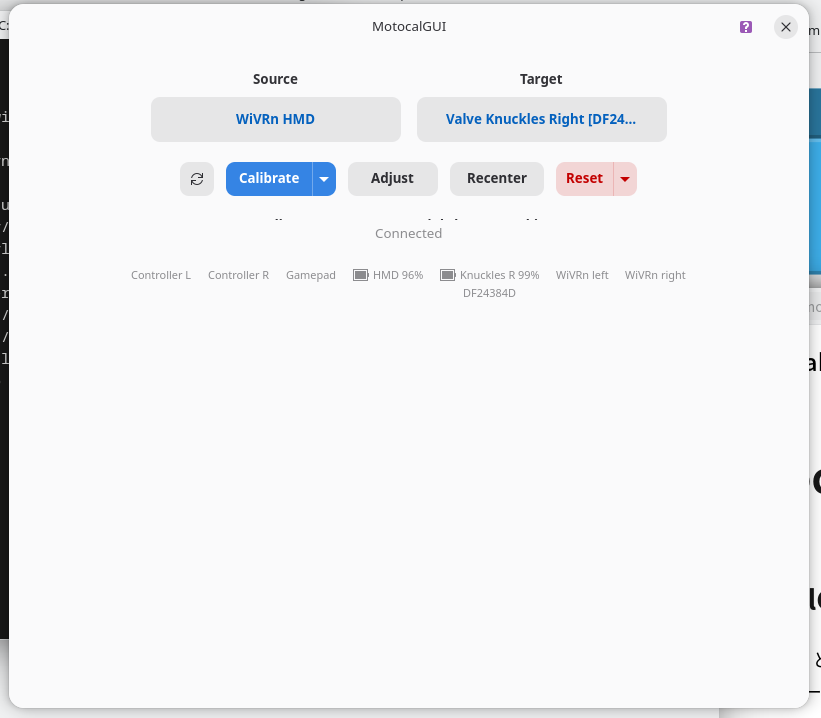
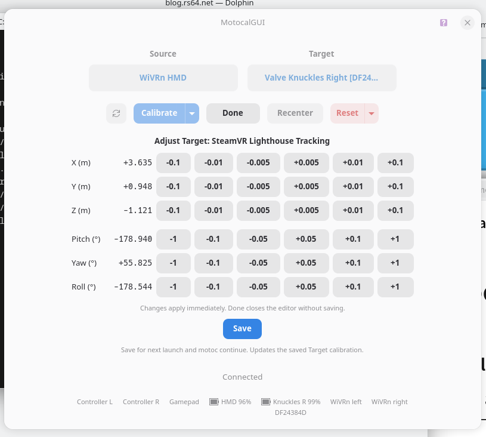
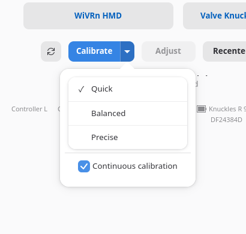

+++
date = '2026-10-19T17:45:16+0900'
title = 'MotocalGUI'
+++

## MotocalGUI

MotocalGUI という、 WiVRn/Monado 向け異種混合トラッキング環境向けの空間合わせ GUI ツールを AI にキメラさせることで作らせ Github にて公開しました。

https://github.com/ReinaS-64892/MotocalGUI

## 何故作らせた

まず motoc / motoc tui : https://github.com/galister/motoc

良い点

- motoc continue で前回のキャリブレーション値を引き継げる
- adjust 機能がある。(細かい手動微調整が可能)
- 継続的キャリブレーション機能がある (私は使わんけど)

私が気に入らない点

- コマンドラインは基本的に VR (wayvr) では使いづらい
- TUI もあんまり使いやすくない。
  - キャリブレーション時に使う HMD やコントローラーが保存されないため、毎度面倒 
  - キャリブレーションのサンプル量も保存されないため毎度落とすのが面倒
  - そもそも TUI は VR (wayvr) だと UI のサイズが小さくて扱いづらい (毎度フォントサイズを帰るのも面倒だし)

つぎに spacecal-for-monado : https://github.com/99oblivius/spacecal-for-monado

良い点

- GUI がシンプルで扱いやすい
- HMD やコントローラーが保存されるため、サイドのキャリブレーションがやりやすい
- キャリブレーションのサンプル量もも保存されるため毎度早めにキャリブレーションを完了させれる。
- GUI で要素がある程度大きいため wayvr からつつきやすい

私が気に入らない点

- キャリブレーション値が保存されないため起動する度必ずキャリブレーションが必須
  - 精度は悪くとも前回の値が引き継げないと wayvr の操作が出来ないため、かなり不便
- Adjust (キャリブレーション値手動調性) ができない。

というふうに2つの WiVRn/Monado で使える空間合わせツールを試したんですが、どっちも一長一短。

私が欲しいと思う要素がどっち行ってもたりてなくて ... 

でも、 GUI は良く、扱いやすい spacecal-for-monado と 機能性に優れる motoc をキメラしてしまえば私の欲しい物になると思ったんですよ ... !

てなわけで、 AI の力で spacecal-for-monado の基盤を libmotoc に差し替えて、いくらか libmotoc の機能を GUI に追加した MotocalGUI ができました。

ついでに、一部のセーブデータ (libmotoc / motoc の範囲) は motoc (CLI/TUI) とセーブデータが共有可能なはずです。

## ギャラリー

